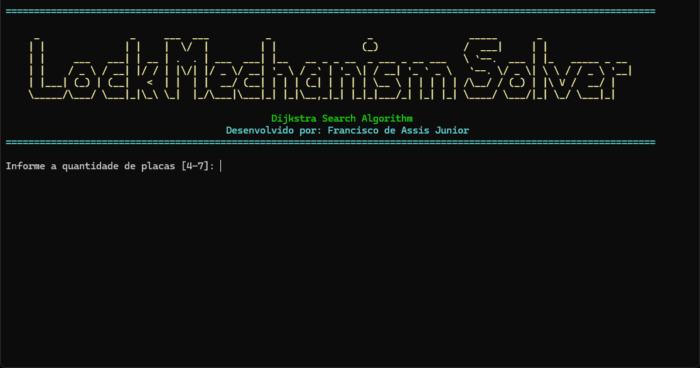

# Gothic Lockpick Solver

<p align="center">
  
</p>

<p align="center">
  A puzzle solver for the lockpicking mechanics found in the Gothic games.
</p>

<p align="center">  </p>

## 🎮 About

Gothic Lockpick Solver is a tool designed to help players solve the lockpicking puzzles from the Gothic series.

Configure the lock's initial pin values and movement rules, and let the program calculate a sequence of movements to reach the correct combination.

**The program interface is currently available in Brazilian Portuguese.**

## ✨ Features

- Custom initial pin configuration.
- Automatic solution calculation.
- Multiple solution display formats.
- Full command-line aplication
- Completely intuitive interface
  
## 🚀 Getting Started

### Executable

1. Download the latest version from the [Releases](../../releases) page.
2. Run the executable.

### Running from Source

Make sure Python 3.x is installed.

Clone the repository:

```bash
git clone https://github.com/FranciscoFernandesJr/gothic-lockpick-solver.git
```

Run the program:

```bash
python gothic_lockpick_solver.py
```

## ⚙️ How It Works

The solver models the lock mechanics as a directed graph where each node represents a specific pin configuration:

* **Graph Exploration:** Uses **Dijkstra's Algorithm** to evaluate valid pin movements and find the optimal path.
* **State Tracking:** Keeps track of visited configurations and edge weights to prevent infinite loops and optimize traversal.
* **Target State:** Computes the shortest sequence of actions until all pins reach the solved state (value **4**).
  

## 📌 Project Status

Currently functional.

Future improvements may include additional features and interface language options.

---

Developed by [Francisco Junior](https://github.com/FranciscoFernandesJr).
